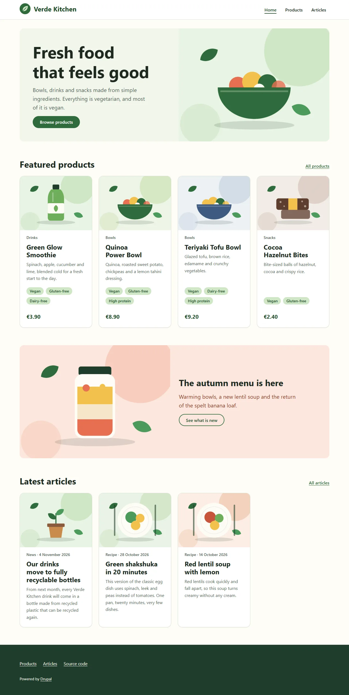
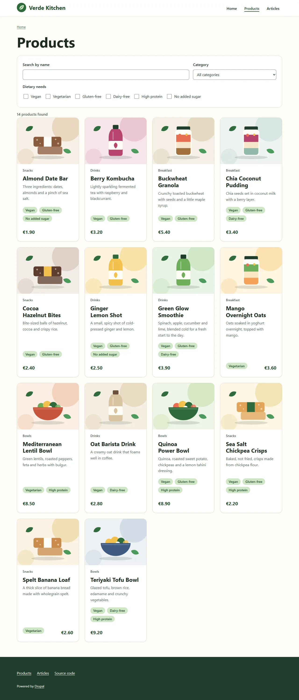
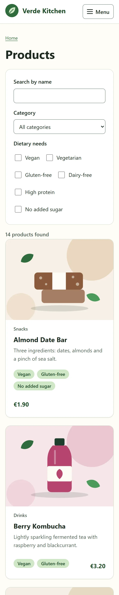
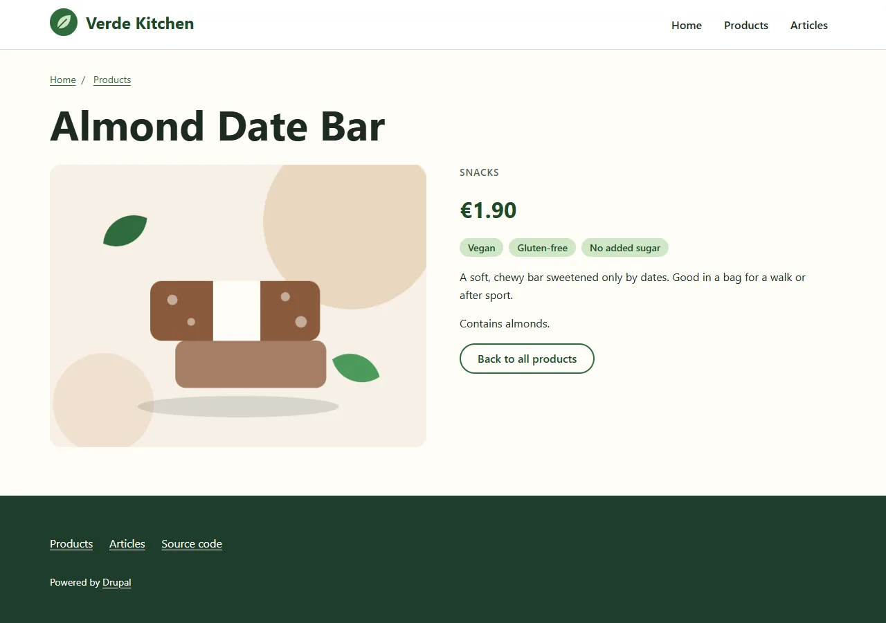
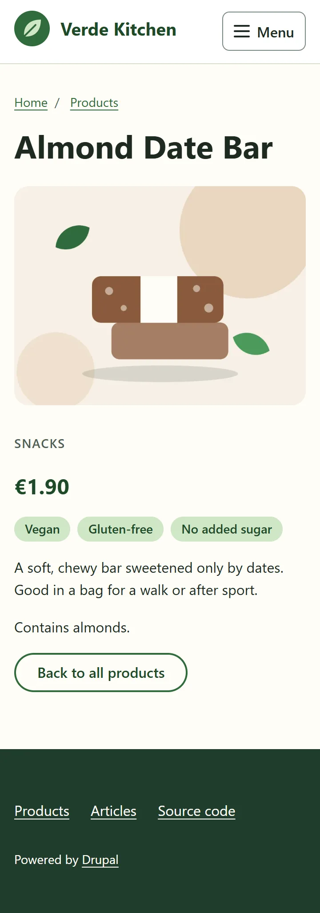

# Verde Kitchen — Drupal 11 front-end portfolio project

A small marketing website for a **fictional** healthy food and drinks brand, built to
practise and demonstrate Drupal front-end development: a custom theme, Twig, Single
Directory Components, SCSS, a React widget fed by JSON:API, accessibility,
performance and SEO.

> Verde Kitchen is an invented brand. It is not connected to any real company.

**Status:** complete. Built in seven phases; the history is in the [pull requests](https://github.com/IvanKhamar/verde-kitchen-drupal/pulls?q=is%3Apr).

## Stack

| Area      | Tool                                                                                                                    |
| --------- | ----------------------------------------------------------------------------------------------------------------------- |
| Local env | [DDEV](https://ddev.com/) 1.25 (Docker)                                                                                 |
| CMS       | Drupal 11.4 (`drupal/recommended-project`), Drush 13                                                                    |
| Runtime   | PHP 8.4, MariaDB 11.8, Node.js 24                                                                                       |
| Theme     | Custom theme `verde` (no base theme), Twig, Single Directory Components, Views                                          |
| Front end | SCSS with design tokens, Webpack 5, Babel, PostCSS/Autoprefixer, React 19 (one widget)                                  |
| Data      | JSON:API (Drupal core, read-only), a small custom module for a computed field                                           |
| SEO       | Pathauto, Metatag (with Open Graph), JSON-LD from the theme                                                             |
| Quality   | ESLint, Stylelint, Prettier, PHP_CodeSniffer (Drupal standards), Node test runner, Lighthouse, axe-core, GitHub Actions |

## Requirements

- [Docker](https://docs.docker.com/get-docker/) (Docker Desktop, or another provider DDEV supports)
- [DDEV](https://docs.ddev.com/en/stable/users/install/ddev-installation/) 1.25 or newer

PHP, Composer, Node.js and the database all run inside the DDEV containers, so nothing
else has to be installed on the host.

## Getting started

```bash
git clone https://github.com/IvanKhamar/verde-kitchen-drupal.git
cd verde-kitchen-drupal
ddev start
ddev composer install
ddev npm ci
ddev npm run build
ddev site-setup
ddev launch
```

`npm run build` compiles the theme's SCSS into `web/themes/custom/verde/dist/`. The
built files are not committed, so this step is required.

`ddev site-setup` (defined in `.ddev/commands/web/site-setup`) installs Drupal from the
exported configuration in `config/sync` and then creates the demo content. It deletes the
current database, so it is also the way to reset the site.

To log in as the administrator, run `ddev drush user:login` and open the link it prints.

The two steps can also be run one by one:

```bash
ddev drush site:install --existing-config --account-name=admin -y
ddev drush php:script scripts/demo-content/demo-content.php
```

## Content model

| Content type | Fields                                                                      |
| ------------ | --------------------------------------------------------------------------- |
| Product      | title, image, description (with summary), category, dietary tags, price (€) |
| Article      | title, article type (recipe / news), image, body                            |

| Vocabulary       | Terms                                                                    |
| ---------------- | ------------------------------------------------------------------------ |
| Product category | Drinks, Bowls, Snacks, Breakfast                                         |
| Dietary tag      | Vegan, Vegetarian, Gluten-free, Dairy-free, High protein, No added sugar |

| Custom block type | Fields                                             |
| ----------------- | -------------------------------------------------- |
| Banner            | variant (hero / promo), heading, text, link, image |

Demo content: 14 products, 5 articles, 2 banners and the main and footer menu links,
created by `scripts/demo-content/demo-content.php`. Products marked "Promoted to front
page" are the featured products on the home page.

## Pages

| Path                               | What it shows                                          | Built with                       |
| ---------------------------------- | ------------------------------------------------------ | -------------------------------- |
| `/`                                | Hero, featured products, promo banner, latest articles | Views page + blocks on `<front>` |
| `/products`                        | Product catalog                                        | View `products`                  |
| `/articles`                        | Recipes and news, newest first, 6 per page             | View `articles`                  |
| `/products/NAME`, `/articles/NAME` | Product or article page (clean URLs from Pathauto)     | `node--TYPE--full.html.twig`     |

## Components

The theme's UI parts are [Single Directory Components](https://www.drupal.org/docs/develop/theming-drupal/using-single-directory-components)
in `web/themes/custom/verde/components/`. Each folder holds the component's metadata
(`*.component.yml`, with a JSON schema for its props), Twig template, SCSS and, if needed, JS.

| Component     | Used for                                                        |
| ------------- | --------------------------------------------------------------- |
| `button`      | Calls to action (link or `<button>`)                            |
| `badge`       | Dietary tags, article type                                      |
| `card`        | Product and article teasers; the whole card is clickable        |
| `hero`        | Home hero (`<h1>`) and promo banner                             |
| `teaser-grid` | Every list of cards; responsive grid without media queries      |
| `navigation`  | Main menu with an accessible mobile toggle (disclosure pattern) |

## React catalog filter

`/products` has a React widget that filters products by name, category and dietary
tags. Source: `web/themes/custom/verde/src/js/catalog-filter/`.

- **Data:** JSON:API (`/jsonapi/node/product`, `/jsonapi/taxonomy_term/...`).
  Category and name search are filtered by Drupal; "all selected tags" is filtered in
  the browser, because two JSON:API conditions on the same multi-value field never
  match together (one SQL join, one value per row).
- **Images:** the `verde_catalog` module adds a computed field `card_image_url` with
  the "card" image style URL. Only Drupal can create that URL (it contains a security
  token), and React then uses the same image file as the Twig cards.
- **Mounting:** the library `verde/catalog-filter` is attached only by the catalog
  template; `Drupal.behaviors` and `once()` mount React into `[data-catalog-filter]`.
- **Progressive enhancement:** the server-rendered list stays visible until the first
  API response, and also when JavaScript or the API fails.
- **States and accessibility:** loading, results, empty and error (with "Try again");
  the result count is announced through a `role="status"` live region; native form
  controls with labels, so the widget works with the keyboard.
- **Tests:** `npm test` runs unit tests for the JSON:API helpers with Node's built-in
  test runner.

## Working with configuration

Content types, fields, displays and other settings live in `config/sync` as YAML files.
After changing settings in the admin UI, export them and commit the result:

```bash
ddev drush config:export -y
```

To apply configuration from the repository to your database (for example after `git pull`):

```bash
ddev drush config:import -y
```

## Front-end build

`package.json` and `webpack.config.js` sit in the project root, outside the web root,
so `node_modules/` is never served by the web server.

| Command              | What it does                                                     |
| -------------------- | ---------------------------------------------------------------- |
| `ddev npm run build` | Production build: compressed CSS, no source maps                 |
| `ddev npm run watch` | Development build with source maps; rebuilds when a file changes |
| `ddev npm test`      | JavaScript unit tests (`*.test.js`)                              |

Node.js runs in the DDEV container (version 24, see `.nvmrc`). With Node.js 24 on the
host, the same commands work without `ddev`.

`npm run screenshots` (`scripts/screenshots.mjs`) takes full-page screenshots at 360, 768 and 1280 px with a
local Chrome or Edge, through the Chrome DevTools Protocol (no extra packages):

```bash
CHROME_PATH="/path/to/chrome" BASE_URL="http://127.0.0.1:PORT" npm run screenshots
```

`ddev describe` shows the `127.0.0.1` address. Recent Chromium versions block pages on
public domains that resolve to `127.0.0.1` (such as `*.ddev.site`), so use that direct address.

While working on the theme, turn off CSS/JS aggregation and Twig caching
(Admin > Configuration > Development > Development settings), so changes show up
on reload.

## Project structure

```text
.ddev/                  DDEV configuration and the site-setup command
config/sync/            Exported Drupal configuration
scripts/demo-content/   Demo content script and its images
scripts/ci/             Scripts used by GitHub Actions
scripts/audit.mjs       Lighthouse and axe audit (npm run audit:site)
scripts/screenshots.mjs Screenshots at three widths (npm run screenshots)
scripts/lib/            Small Chrome DevTools Protocol client used by both
scripts/scaffold/       Lines Composer scaffold appends to .gitattributes
web/                    Web root (Drupal core and contributed code are installed by Composer)
web/modules/custom/verde_catalog/
                        Computed "card image URL" field for JSON:API
web/themes/custom/verde/
  verde.info.yml        Theme definition: regions, global library
  verde.libraries.yml   CSS/JS libraries
  verde.theme           Preprocess functions and template suggestions (PHP)
  components/           Single Directory Components (Twig, SCSS, JS)
  templates/            Twig templates that override Drupal's defaults
  src/scss/             SCSS sources: abstracts (tokens, mixins), base, layout, components, pages
  src/js/               React widget sources and their unit tests
  dist/                 Build output (not committed)
docs/                   Project documentation
composer.json           PHP dependencies
package.json            Front-end build tools and npm scripts
webpack.config.js       Webpack configuration
```

## Continuous integration

GitHub Actions runs three jobs on every push:

| Job       | What it checks                                                                                                                                                                                                                           |
| --------- | ---------------------------------------------------------------------------------------------------------------------------------------------------------------------------------------------------------------------------------------- |
| `secrets` | gitleaks scans the whole history for keys and passwords                                                                                                                                                                                  |
| `lint`    | `npm run lint` (ESLint, Stylelint, Prettier) and `composer lint` (PHP_CodeSniffer with the Drupal and DrupalPractice standards)                                                                                                          |
| `build`   | Composer and npm audits, JavaScript unit tests, the Webpack build, then a site install from `config/sync` into an empty MariaDB database with the demo content, a smoke test (`scripts/ci/install-test.sh`) and a Lighthouse + axe audit |

The CI site runs on PHP's built-in server instead of DDEV: installing Drupal from config and
auditing the pages needs only PHP and a database, which start in seconds, while DDEV would
first pull several Docker images on every run. Lighthouse's Performance score is reported but
not enforced in CI, because timings on shared CI machines vary from run to run; Accessibility,
Best Practices, SEO (90 or more) and axe (no critical or serious issues) are enforced. The
reports are kept as a build artifact.

Run the same checks locally:

```bash
ddev npm run lint
ddev composer lint
ddev npm test
```

## Secrets

No secret is stored in this repository. `settings.php` is committed without credentials:
DDEV generates `settings.ddev.php` (git-ignored) with the local database credentials and a
random hash salt. Outside DDEV, set the `DRUPAL_HASH_SALT` environment variable.
Every push is scanned with [gitleaks](https://github.com/gitleaks/gitleaks).

## Screenshots

| Desktop (1280 px)                                                                    | Mobile (360 px)                                                                    |
| ------------------------------------------------------------------------------------ | ---------------------------------------------------------------------------------- |
|                           |                           |
|  |  |
|                     |                     |

Made with `npm run screenshots` and converted to WebP.

## Performance, accessibility and SEO

### Lighthouse and axe results

Lighthouse, mobile preset (emulated phone, slow 4G, 4x CPU slowdown), on the local DDEV site:

| Page    | Performance | Accessibility | Best Practices | SEO |
| ------- | ----------: | ------------: | -------------: | --: |
| Home    |         100 |           100 |            100 | 100 |
| Catalog |          98 |           100 |            100 | 100 |
| Product |         100 |           100 |            100 | 100 |
| Article |         100 |           100 |            100 | 100 |

axe-core (WCAG 2.0/2.1 A and AA, plus best practices): **0 violations** on all four pages at
360 and 1280 px, with the mobile menu open and with the catalog filter applied.

Full numbers (LCP, CLS, TBT per page): [`docs/audit-results.md`](docs/audit-results.md).
Run the audit yourself:

```bash
CHROME_PATH="/path/to/chrome" BASE_URL="http://127.0.0.1:PORT" npm run audit:site
```

It writes HTML reports to `reports/` (not committed) and exits with code 1 when a score is
under 90 or axe finds a critical or serious issue.

### What makes it fast

- **Responsive images:** `srcset` + `sizes` (responsive image styles `card` and `detail`),
  WebP files, `width`/`height` attributes against layout shift.
- **Loading priority:** the hero and the main image of a product or article page load
  eagerly with `fetchpriority="high"` (the LCP image); the first row of cards in a list is
  eager; everything below loads lazily.
- **Little JavaScript:** pages load only the navigation behaviour; React (71 KB gzip) loads
  only on `/products`. CSS and JS are aggregated, component CSS loads only where the
  component is used.
- **No layout shift:** the mobile menu and the catalog filter get their final layout from
  CSS (`@media (scripting: enabled)`), before any script runs.
- **System fonts:** nothing to download, so no font swap.
- **Caching:** Drupal's page cache, and `Cache-Control: max-age=3600, public` for browsers and CDNs.

### Accessibility

Skip link, landmarks (`header`, `nav` with labels, `main`, `footer`), one `<h1>` per page and
no skipped heading levels, visible `:focus-visible` outlines, WCAG AA contrast for every colour
pair ([`docs/design-tokens.md`](docs/design-tokens.md)), 44 px touch targets, required alt
texts, a disclosure-pattern mobile menu (Escape closes it), and a live region for filter results.

### SEO

- **Clean URLs:** Pathauto patterns `products/[node:title]` and `articles/[node:title]`.
- **Meta tags:** Metatag sets the title, description and canonical URL per page type
  (global, front page, content, and the listing views through Metatag Views).
- **Open Graph:** `og:title`, `og:description`, `og:image` (a 1200x630 "social" image style) and more.
- **Structured data:** the theme adds JSON-LD (`Product` with an `Offer`, `Article`) in
  `verde_page_attachments_alter()`. The JSON is encoded with `JSON_HEX_TAG`, so text with
  `</script>` cannot break out of the script element.

## Documentation

- [`docs/ARCHITECTURE.md`](docs/ARCHITECTURE.md) — theme structure, data flow from Drupal to Twig and to React, caching
- [`docs/LEARNING.md`](docs/LEARNING.md) — how Drupal theming works in this project, with interview questions
- [`docs/design-tokens.md`](docs/design-tokens.md) — colours (with WCAG contrast ratios), typography, spacing, breakpoints

Image and content credits: `CREDITS.md`.

## License

Code: GPL-2.0-or-later, the same as Drupal (see `LICENSE.txt`).
