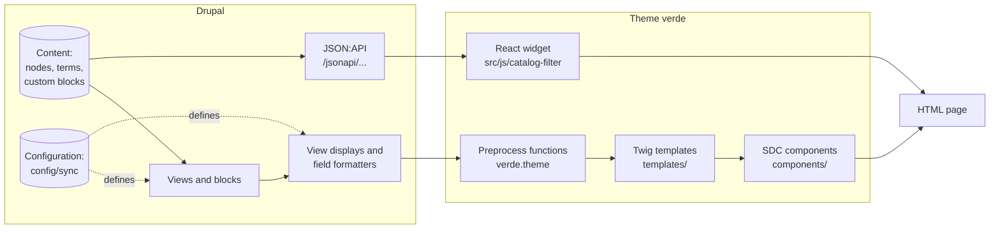
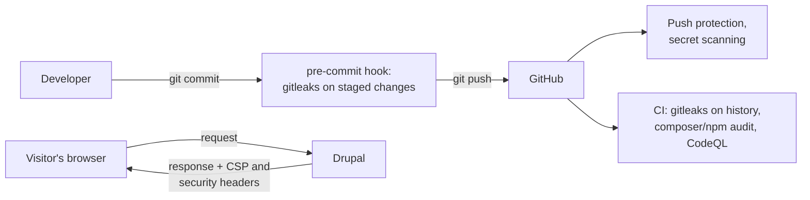

# Architecture

How the Verde Kitchen site is put together: the theme's structure, how data travels from
Drupal to Twig and to React, and where performance, accessibility and SEO are handled.

## Overview



- **Configuration** (content types, fields, views, blocks, image styles, meta tags) lives in
  `config/sync` and is installed with `drush site:install --existing-config`.
- **Content** (products, articles, terms, banners, menu links) is created by
  `scripts/demo-content/demo-content.php`.
- **Server rendering** builds every page: render arrays → preprocess → Twig → SDC components.
- **Client rendering** is used once: the React catalog filter reads JSON:API.

## Theme structure

```text
web/themes/custom/verde/
├── verde.info.yml           Theme definition: no base theme, regions, global library
├── verde.libraries.yml      Libraries: global, product, article, catalog-filter
├── verde.breakpoints.yml    Breakpoints for responsive image styles
├── verde.theme              Preprocess functions, suggestions, JSON-LD
├── logo.svg
├── components/              Single Directory Components
│   ├── badge/               badge.component.yml, badge.twig, badge.scss
│   ├── button/
│   ├── card/
│   ├── hero/
│   ├── navigation/          + navigation.js (mobile toggle)
│   └── teaser-grid/
├── templates/
│   ├── layout/              html, page, region
│   ├── block/               block, block--system-branding-block, block--banner,
│   │                        block--system-menu-block--main
│   ├── content/             node--teaser, node--product--full, node--article--full
│   ├── field/               field
│   ├── navigation/          menu--main, menu, breadcrumb
│   └── views/               views-view-unformatted, views-view--products--page-catalog
├── src/
│   ├── scss/                abstracts (tokens, mixins), base, layout, components, pages
│   └── js/catalog-filter/   React widget and its unit tests
└── dist/                    Build output (not committed)
```

There is no base theme (`base theme: false`). Templates the theme does not override come from
the module that owns them (for example `system` for status messages). This keeps the markup
small and every template the theme changes is in `templates/`.

## From content to HTML

### A product page

1. The URL `/products/green-glow-smoothie` is a path alias (made by Pathauto) for `/node/N`.
2. The node is rendered in the **full** view mode. The view display
   (`core.entity_view_display.node.product.default`) decides which fields are shown and with
   which **formatter**: the image with the responsive image formatter, the price as a decimal…
3. Drupal looks for the most specific template. For a product in the full view mode the
   candidates are `node--N--full`, `node--N`, `node--product--full`, `node--product`,
   `node--full`, `node`. The theme has `node--product--full.html.twig`.
4. Before the template runs, **preprocess functions** prepare variables
   (`verde_preprocess_node()`): classes, the formatted price, dietary tags as plain strings,
   the category name, and the cache tags of those terms.
5. `verde_preprocess_field()` picks the responsive image style and the loading strategy for
   the image (`eager` + `fetchpriority="high"`, because it is the LCP image).
6. The template prints fields (`{{ content.body }}`) and components
   (`include('verde:badge', …)`), and attaches the `verde/product` library.
7. The page is wrapped by `page.html.twig` (regions) and `html.html.twig` (`<head>`, skip link).
8. `verde_page_attachments_alter()` adds JSON-LD; Metatag adds meta and Open Graph tags.

### The home page

The front page is the `home` display of the `products` view (`/home`): featured products, which
are products "Promoted to front page". Blocks placed in the content region, visible only on
`<front>`, add the rest:

| Weight | Block                  | Renders as                                  |
| -----: | ---------------------- | ------------------------------------------- |
|    -20 | Banner "Home hero"     | `block--banner` → `hero` component (`<h1>`) |
|      0 | Main content: the view | `teaser-grid` with "Featured products"      |
|     10 | Banner "Home promo"    | `hero` component, promo variant             |
|     20 | View block "Latest"    | `teaser-grid` with "Latest articles"        |

The page title block is hidden on `<front>`, so the hero heading is the page's only `<h1>`.

### Lists of cards

Every list (featured products, catalog, articles) uses the "Unformatted list" Views style:

```text
views-view-unformatted.html.twig  →  teaser-grid component (heading, "see all" link, <ul>)
  └─ each row: node in the teaser view mode
       node--teaser.html.twig     →  card component (props from verde_preprocess_node)
```

`verde_preprocess_views_view_unformatted()` adds the section heading on the home page, and
marks the first two cards of a listing page as "eager" (their images are in the first screen).

## Components (SDC)

A component is a folder with:

- `NAME.component.yml`: name, description, **props** (a JSON schema) and **slots**;
- `NAME.twig`: the markup;
- `NAME.scss` → compiled to `NAME.css` next to it (Drupal loads it automatically);
- `NAME.js` if needed (`navigation.js`).

Drupal creates a library per component (`core/components.verde--card`) and attaches it only
where the component is rendered. Props are plain values checked against the schema (when PHP
assertions are on, as in DDEV). Slots take any markup, for example a rendered field.

Rule used everywhere: **PHP prepares plain data, Twig decides the markup, components receive
only plain props.** Components do not know about Drupal entities, so they could be reused or
shown in a component library as they are.

## Styles and scripts

| Source                                        | Output                                | Loaded                       |
| --------------------------------------------- | ------------------------------------- | ---------------------------- |
| `src/scss/global.scss`                        | `dist/css/global.css`                 | every page (`verde/global`)  |
| `src/scss/pages/product.scss`, `article.scss` | `dist/css/product.css`, `article.css` | full product / article pages |
| `src/scss/pages/catalog-filter.scss`          | `dist/css/catalog-filter.css`         | `/products`                  |
| `components/*/NAME.scss`                      | `components/*/NAME.css`               | where the component is used  |
| `src/js/catalog-filter/index.jsx`             | `dist/js/catalog-filter.js` (React)   | `/products`                  |
| `components/navigation/navigation.js`         | (no build step)                       | where the menu is rendered   |

Webpack (`webpack.config.js`) runs Sass → PostCSS (Autoprefixer) for styles and Babel for JSX.
Drupal aggregates the CSS and JS files of a page into a few files.

Design tokens (`src/scss/abstracts/_tokens.scss`) are Sass maps turned into CSS custom
properties; see [`design-tokens.md`](design-tokens.md).

## The React catalog filter

```mermaid
sequenceDiagram
  participant B as Browser
  participant D as Drupal (Twig)
  participant R as React widget
  participant A as JSON:API
  B->>D: GET /products
  D-->>B: HTML with the full product list + <div data-catalog-filter>
  B->>R: Drupal.behaviors.verdeCatalogFilter.attach() mounts React
  R->>A: GET /jsonapi/taxonomy_term/product_category, /dietary_tag
  R->>A: GET /jsonapi/node/product?filter[...]&fields[...]
  A-->>R: products (with card_image_url)
  Note over R,B: The server list stays until the user picks a filter
  B->>R: user types "bowl" (debounced 300 ms)
  R->>A: GET /jsonapi/node/product?filter[search]...
  A-->>R: 3 products
  R-->>B: React results replace the server list; "3 products found" is announced
```

- **Mounting:** the catalog template adds the mount point with `data-*` settings and attaches
  the `verde/catalog-filter` library. `Drupal.behaviors` + `once()` mount React once per element.
- **Data:** `api.js` builds JSON:API URLs (`filter[...]`, `fields[...]`, `sort`) and maps the
  response to plain objects. Category and name are filtered by Drupal. "All selected dietary
  tags" is filtered in the browser: two conditions on the same multi-value field never match
  together in JSON:API (one SQL join, one value per row).
- **Images:** the `verde_catalog` module adds a computed field `card_image_url` with the URL
  of the "card" image style. Only Drupal can create that URL (it carries a security token).
- **States:** loading (old results dimmed, `aria-busy`), results, empty, error with "Try again".
  "Loading" is derived from state, not stored. Old requests are cancelled with `AbortController`.
- **Progressive enhancement:** without JavaScript, or if the API fails, the server list stays.

## Caching

| Layer              | What it does here                                                      |
| ------------------ | ---------------------------------------------------------------------- |
| Page cache         | Whole pages for anonymous users; `Cache-Control: max-age=3600, public` |
| Dynamic page cache | Pages for logged-in users, minus personalised parts                    |
| Render cache       | Rendered nodes, blocks and views, invalidated by **cache tags**        |

Theme code adds cache metadata where it reads data:

- term cache tags in `verde_preprocess_node()` (a renamed tag updates every card);
- the `url.path.is_front` cache context, because cards use `<h3>` on the home page and `<h2>` elsewhere;
- an extra cache key for the "eager" first cards of a listing.

## SEO

- **Pathauto:** `products/[node:title]`, `articles/[node:title]`.
- **Metatag:** defaults for the whole site, the front page, content and products (`og:type`
  product); Metatag Views for `/products` and `/articles`.
- **Open Graph:** title, description, URL and a 1200x630 image (`social` image style).
- **JSON-LD:** `Product` (with an `Offer`) and `Article`, added by the theme.

## Security



**Keeping secrets out of a public repository**

- No credentials in committed files: `settings.php` reads the hash salt and trusted host
  patterns from the environment; DDEV writes the local database settings to the git-ignored
  `settings.ddev.php`.
- `.githooks/pre-commit` runs gitleaks on the staged changes and blocks the commit on a
  finding. `.gitleaks.toml` adds rules for database URLs with passwords and Drupal hash salts.
- CI runs gitleaks over the whole history; GitHub secret scanning and push protection are on.
- CI logs are public too: the install test gives the throwaway CI site a random admin
  password that it never prints.

**HTTP response headers**

| Header                    | Value / effect                                                                                                                       | Set by                      |
| ------------------------- | ------------------------------------------------------------------------------------------------------------------------------------ | --------------------------- |
| `Content-Security-Policy` | `default-src 'self'`, `img-src 'self' data:`, `object-src 'none'`, `base-uri 'self'`, `form-action 'self'`, `frame-ancestors 'none'` | CSP module (`csp.settings`) |
| CSP for administrators    | `style-src 'self' 'unsafe-inline'` (Claro and the toolbar use `style=""`)                                                            | `verde_security`            |
| `X-Frame-Options`         | `DENY` (for browsers without `frame-ancestors`)                                                                                      | `verde_security`            |
| `X-Content-Type-Options`  | `nosniff`                                                                                                                            | Drupal core                 |
| `Referrer-Policy`         | `strict-origin-when-cross-origin`                                                                                                    | `verde_security`            |
| `Permissions-Policy`      | camera, microphone, geolocation, payment, USB: off                                                                                   | `verde_security`            |

`drupalSettings` and JSON-LD are inline `<script>` elements, but with a data type
(`application/json`, `application/ld+json`): browsers never execute them, so the strict
policy does not block them, and no `'unsafe-inline'` is needed for scripts.

**Drupal**

- JSON:API in read-only mode; only administrators create accounts; errors are hidden from
  visitors; flood control limits failed logins; Automated Cron runs maintenance tasks.
- Output escaping: Twig autoescape, React's text rendering, `JSON_HEX_TAG` for JSON-LD.
- Security Review (`drush security:review`) passes, except points that depend on the server
  (file permissions, the uid 1 account), which the production setup handles.

## Quality checks (GitHub Actions)

| Job       | Steps                                                                                                                          |
| --------- | ------------------------------------------------------------------------------------------------------------------------------ |
| `secrets` | gitleaks over the whole history                                                                                                |
| `lint`    | ESLint, Stylelint, Prettier; PHP_CodeSniffer (Drupal, DrupalPractice)                                                          |
| `build`   | Composer and npm audits, JS unit tests, Webpack build, site install from config + demo content, smoke test, Lighthouse and axe |

The site runs in CI without DDEV: PHP's built-in server and a MariaDB service container are
enough to install Drupal from config and audit the pages, and they start in seconds, while
DDEV would first pull several Docker images. Lighthouse's Performance score is not enforced
in CI because shared machines make timings unreliable; it is measured on the DDEV site
(`docs/audit-results.md`).
